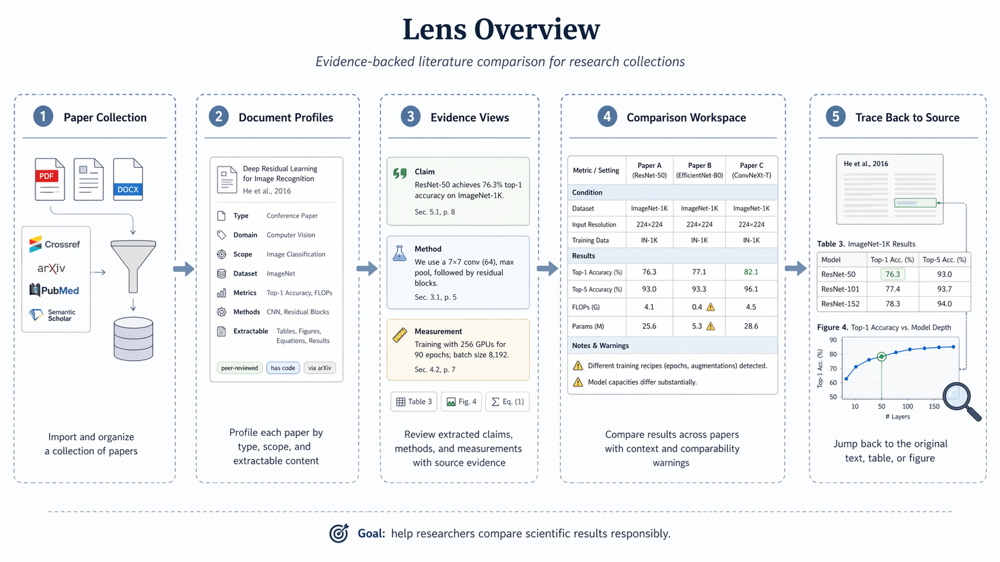

# Lens

<p align="center">
  
</p>

Lens is a research system in development. Its purpose is to help a researcher
study a question until the available knowledge and methods support a useful,
understandable judgment.

Lens starts from a researcher's problem and existing knowledge, then uses the
available papers, source material, tools, and analysis methods to reduce the
important uncertainty around that problem. It can identify useful papers,
inspect the relevant parts of their sources, reconstruct facts and conditions,
compare results, expose gaps, and help decide what to investigate next.

Source, Evidence, PaperExperiment, Comparison, and Finding are the research
state that makes this work traceable, reviewable, and reusable. They support the
research process; they are not a substitute for understanding the question the
researcher is trying to answer.

<p align="center">
  
</p>

---

## The Research Problem

A useful research result cannot be separated from the conditions that produced
it. Two papers may report the same measurement while using different materials,
processing routes, sample states, baselines, or test methods. A fluent summary
can hide those differences and make an unsupported comparison sound certain.

Lens helps the researcher work through that problem:

- clarify what needs to be understood or decided
- find the papers and source passages that can answer it
- reconstruct the facts, variables, conditions, and measurements
- compare only the parts that the available information supports
- distinguish reported facts, interpretations, hypotheses, and unknowns
- preserve the source trail for each important judgment
- identify the next useful inspection or research action

The product is collection-bound in its current phase. A collection provides the
papers and prepared sources that the researcher can investigate together. The
Research Agent helps navigate and reason over that material, while the Core
artifacts preserve the durable research state.

## Current Product

Lens v1 is a reviewable workspace for researching questions across a collection
of papers. Its primary acceptance surface is the collection comparison
workspace, where a researcher can see which results are comparable, which
conditions are missing, and which judgments need review.

The current workflow is:

```text
Paper collection
  -> document preparation and Source
  -> Document Profile
  -> researcher selects ready papers
  -> optional Paper Map for navigation
  -> research question and Objective
  -> source inspection
  -> PaperExperiment facts and source bindings
  -> comparison and Finding
  -> review, correction, and next decision
```

Paper preparation and Paper Map construction are separate stages. A Paper Map
is a lazy navigation aid for locating materials, processes, variables, outcomes,
and relevant source units. It is not a prerequisite for reading a prepared
paper. When a map is absent or incomplete, the researcher or Agent can still
inspect the document outline and read the relevant source passages directly.

The current product includes:

- paper collection management and independent document preparation
- document profiles for paper type and preparation state
- canonical Source reading with section, page, table, and figure context
- research-question and Objective scope formation
- source-grounded PaperExperiment revisions for experimental facts
- comparison views that retain conditions, baselines, and uncertainty
- Finding review and source traceback
- a collection-bound Research Agent for read-only investigation and
  reviewable drafts, with explicit approval for durable writes

## Research State

The system records different kinds of information for different purposes:

| Object | Role in the research process |
| --- | --- |
| `Source` | Prepared content from the original paper, including passages, tables, captions, and source locations. |
| `DocumentProfile` | A coarse description of the paper and its preparation state. It helps route work but is not scientific evidence. |
| `PaperMap` | Optional navigation metadata for a paper's scope, variables, outcomes, and source coverage. It helps find what to read but is not Evidence. |
| `PaperExperiment` | A reusable, source-grounded reconstruction of one paper's experiment, conditions, variants, and measurements. |
| `Comparison` | A view of facts across papers with their comparability and unresolved conditions made explicit. |
| `Finding` | A reviewable research conclusion connected to fixed selections and source-grounded facts. |

The Agent may use titles, filenames, profiles, maps, and search results to choose
where to look. Formal scientific claims must remain grounded in inspected
Sources and the corresponding structured records. A missing artifact, failed
read, and information that the paper never reports are different states and
must remain different in the research record.

## Research Agent

The Research Agent is a collection-bound research collaborator. Its job is to
understand what the researcher wants to know, choose useful next actions, and
continue the investigation with the available material and tools.

For a source-backed question, it can:

1. identify candidate papers by title, filename, profile, or conversation
   context;
2. inspect document outlines and choose relevant sections;
3. read complete passages, tables, and captions, following continuation pages
   when needed;
4. organize each paper's result, conditions, baseline, measurement, and source;
5. compare supported parts across papers and explain what remains uncertain;
6. prepare a structured draft for a researcher to review.

The Agent does not treat a filename, a Paper Map, a search match, or a fluent
answer as proof. It does not turn a technical failure into a scientific
conclusion. Durable experiment, Finding, and research-plan writes retain the
existing user approval boundary.

## Current Boundary

Lens v1 is not a generic paper-chat product, a science news feed, a universal
scientific search engine, or an autonomous scientist. Current limitations
include:

- external retrieval, simulation, laboratory execution, and result ingestion
  are not a completed Lens workflow;
- human review remains required for scientific corrections and durable writes;
- a paper can remain unresolved when its prepared source is incomplete or the
  required fact is not reported;
- protocol and experiment planning outputs are conditional downstream value,
  not the primary acceptance surface;
- materials science is the first proving vertical, not the permanent product
  boundary.

The system should be useful even when a collection is mixed, review-heavy, or
unable to produce a protocol. It should say when a result is insufficient,
not comparable, or not extractable instead of manufacturing certainty.

## Materials Science First

Materials research is the first proving vertical because a reported property
usually depends on several linked conditions:

- material composition and state
- synthesis or fabrication route
- processing and post-treatment
- sample geometry and orientation
- test method and environment
- comparison baseline
- measurement units and reporting convention

Lens is designed to make those dependencies visible while keeping the broader
research pattern extensible to other experimental and technical domains.

## Longer-Term Direction

The longer-term direction is a supervised research loop that can move from a
research goal through existing knowledge, hypotheses, experiment choices, new
observations, and updated decisions. The loop is deliberately incremental:

```text
Research problem and constraints
              |
              v
Available knowledge and methods
              |
              v
Source-grounded research state
              |
              v
Judgment, uncertainty, and knowledge gap
              |
              v
Next useful investigation or experiment
              |
              v
New observation -> updated research state
```

This is a future direction, not a claim that Lens already runs experiments or
continues autonomously without review. The current v1 evidence and comparison
workflow is the foundation that makes the future loop credible.

## Documentation

Start with [`docs/README.md`](docs/README.md) for the shared documentation map.

Product scope and contracts:

- [`docs/contracts/lens-v1-definition.md`](docs/contracts/lens-v1-definition.md)
- [`docs/contracts/lens-core-artifact-contracts.md`](docs/contracts/lens-core-artifact-contracts.md)
- [`docs/overview/lens-mission-positioning.md`](docs/overview/lens-mission-positioning.md)

Architecture and decisions:

- [`docs/architecture/lens-v1-architecture-boundary.md`](docs/architecture/lens-v1-architecture-boundary.md)
- [`docs/architecture/paper-facts-and-comparison-current-state.md`](docs/architecture/paper-facts-and-comparison-current-state.md)
- [`docs/decisions/rfc-collection-bound-research-agent.md`](docs/decisions/rfc-collection-bound-research-agent.md)

Module setup and contracts:

- [`backend/README.md`](backend/README.md)
- [`frontend/README.md`](frontend/README.md)
- [`deploy/README.md`](deploy/README.md)

## Development Status

Lens is under active development. Product contracts and architecture documents
describe the current boundary; implementation details and experimental
interfaces may continue to change as the system is tested on real research
collections.

The project is successful when it helps a researcher make a better-supported
judgment, understand why that judgment holds, see what remains uncertain, and
continue the investigation without losing the path back to the original source.
